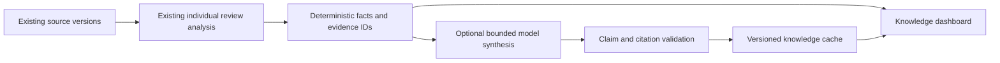

# Reviews Intelligence — from data to knowledge

**Audit and local development complete. Production deployment is held for owner review.** Work is isolated on `codex/reviews-knowledge-phase2`, based on the verified Waste release handoff `f315200`. Production Google/OpenAI integration, the deployed Waste system and the daily 10:00 AM Pacific job remain unchanged.

Working private preview: http://127.0.0.1:4323

Its private sign-in is in `/tmp/wahi-knowledge-preview-20261101/ACCESS.md`. The full classification audit, original feedback, model output and screenshots remain in the isolated worktree's ignored `backend/review/.runtime/knowledge-20261101/` directory. The standalone private audit is `PRIVATE-90-DAY-AUDIT.html`. Customer text, review identifiers, named staff, credentials and production screenshots are not committed to this public repository.

## What the period filters actually show

The production audit used an explicitly read-only, repeatable-read snapshot captured **November 1, 2026 at 21:40 UTC**. Reviews are grouped by their **original posting day in America/Los_Angeles**, not the date Google synchronized them or OpenAI analyzed them.

| Selected filter | Inclusive posting dates | Reviews | Assessed text reviews | Rating-only reviews |
| --- | --- | ---: | ---: | ---: |
| 30 days | October 3 – November 1, 2026 | 10 | 7 | 3 |
| 90 days | August 4 – November 1, 2026 | 30 | 21 | 9 |
| 12 months | November 2, 2025 – November 1, 2026 | 119 | 92 | 27 |

The existing “12 months” preset is **365 rolling days**, not twelve completed calendar months. The proposed preview preserves that selection and explicitly labels posting-date scope.

The **440 historical text assessments span the full retained inventory of 565 reviews**. Only seven of them belong in the current 30-day view. A topic's count is distinct supporting reviews, not the number of model observations; analyzing history does not move older reviews into the current period. There are no unprocessed recent text reviews in this snapshot. The small recent counts are therefore principally a period/volume issue, not evidence that historical classification failed.

All **90 category/period combinations** (29 topic categories plus overall, across three windows) reconcile against an independent reconstruction from the published review manifest. Existing topic counts, sentiment metrics and supplied evidence dates correspond to the selected period. This checks arithmetic and provenance, not whether every interpretation is semantically right.

Two presentation details make the small counts misleading:

- Current overall sentiment buckets are mutually exclusive. In the 30-day period they contain **5 positive-only, 0 negative-only, and 2 mixed reviews**. Both mixed reviews contain negative aspects. The prototype instead labels **7 reviews with praise and 2 with concerns**, with overlap disclosed. For 90 days, the corresponding inclusive counts are **20 with praise and 7 with concerns**, including **6 mixed reviews**; the old overall buckets are 14 positive-only, 1 negative-only and 6 mixed.
- The date preset previously used the UTC day while data grouping uses Pacific time. A local fix now uses the Pacific day, including the boundary where UTC has already advanced to tomorrow. A regression verifies that November 2 at 00:30 UTC is still November 1 Pacific.

Custom full-calendar-month comparisons also deserve an explicit product decision: the current report has a previous-calendar-month special case while the topic overview uses an equal-length preceding window. This does not affect the three audited presets. The new knowledge preview uses clearly labeled equal-length preceding windows consistently; calendar-month comparisons should be a separate labeled option if retained.

## The complete 90-day classification audit

There are exactly **30 reviews** in this window, but only **21 have written feedback**. All 30 were reviewed: the entire available population rather than a selected sample. The nine rating-only records correctly have no invented topic, compliment, complaint or sentiment assessment. The 21 text reviews include positive, negative, mixed, multi-topic, ambiguous, long and unusual feedback.

The private interactive audit and standalone HTML provide, for **each of the 30 reviews**:

1. Original customer feedback and posting date/rating.
2. Every model aspect sentiment, topic and exact source span.
3. Extracted compliments, complaints, suggestions, food/drink mentions and staff references.
4. The dashboard's derived overall sentiment and unique-review contribution to parent/child categories.
5. Correct interpretations, confirmed issues, ambiguities, extraction gaps and proposed corrections.

**Four text-review cases have at least one confirmed topic/polarity/evidence-support issue.** These are reviewer judgments proposed for owner adjudication, not a validated accuracy estimate for all 440 historical assessments. All 21 text results pass the existing structural/span validator; valid structure and high model confidence do not establish semantic correctness.

| Private audit ID | Confirmed issue | Proposed correction |
| --- | --- | --- |
| R07 | A mixed Experience observation cites a positive-only sentence. | Make that individual observation positive, or require a longer quote containing both polarities. Keep the full review mixed through its other supported observations. |
| R14 | A Wait times concern is inferred without any actual waiting/admission-delay statement. | Remove the unsupported Wait times observation. Preserve the review's supported negative aspects. |
| R16 | A descriptive Atmosphere passage is labeled mixed without explicit negative language. | Use neutral descriptive interpretation pending owner judgment; retain the separate suggestion as a preference rather than proof of a recurring defect. |
| R21 | A temperature-specific category is not directly supported by a stated temperature. | Remove that unsupported category while preserving the supported negative Food Quality report. A separate priority human-review annotation remains explicitly unverified, not an established trend. |

Other audit findings include incomplete explicit-compliment extraction, pronoun-only evidence needing adjacent sentence context, generic staff roles being mistaken for names, combined dish subjects needing careful splitting, and source spellings that must not be silently matched to catalog identities. These are documented per review rather than being hidden inside a headline error rate. Prototype item/staff polarity is derived from overlapping same-topic evidence spans, not a separately validated entity-level sentiment classifier; long quotes and pronouns can remain ambiguous. Read the original context before an item- or person-specific conclusion.

The preview can switch between **original published classifications** and **proposed local audit corrections**. The original records are immutable in both views. No production correction or paid reclassification has occurred.

## Why one positive quote appeared as negative evidence

The reported “the food delicious” phrase was **correctly classified positive** by the model. It was not a mixed-sentiment model output.

The confirmed pipeline was:

1. The period's Food Quality metric contained a negative review.
2. The evidence query selected the **three most recent quotes across all polarities**. All three were positive, so the older negative quote was absent.
3. The concern renderer looked for a negative quote and, finding none, used `evidence[0]` as a fallback.
4. That same positive phrase consequently appeared on both sides of the dashboard.

Prepared local corrections select evidence from the **same unique-review/category population as the metric**, include category descendants, balance the bounded three-quote shortlist by polarity, and never fall back to an opposite-polarity quote. A read-only run of the revised query against production confirmed correct negative evidence selection **without changing topic counts**. This defect needs an evidence/rendering fix; wholesale model reanalysis would not repair it.

A separate mismatch affected parent topics: their metrics include child categories, but the old evidence lookup matched direct category IDs only. The local selector now uses the same hierarchy for both.

## Topic aggregation and chart findings

Published metrics count a review once within a topic and its ancestors. Multiple observations remain available for detail but do not create more reviewers. Food/Food Quality and Drinks/Drink Quality are therefore overlapping parent/child sets, not additive independent categories.

For the 30-day view:

- Food has **7** reviews; Food Quality has **6**, all contained in Food. Adding them to 13 would double-count six reviews.
- Drinks has **5** reviews; Drink Quality has **4**, all contained in Drinks. Adding them to nine would double-count four reviews.

For 90 days the corresponding parent/child counts are **Food 17 / Food Quality 14**, and **Drinks 14 / Drink Quality 8**. This is expected rollup behavior; the repetitive cards obscure it. The proposed hierarchy has one expandable parent row with child counts and explicit overlap definitions.

Model observation-strength averages can also be affected by how many overlapping observations a review contains. They are not calibrated satisfaction probabilities. The new knowledge layer favors explicit, deduplicated support/rates and does not treat model self-confidence as evidence of accuracy.

The bar-length defect is independent of the model: the deployed security policy's `style-src 'self'` blocks inline width styles. A controlled Chromium reproduction using that same policy rendered old values **8, 4, 2** as three equally full bars. SVG presentation attributes render the correct **100%, 50%, 25%** proportions without weakening the policy. The prepared legacy fix and prototype both use SVG widths, with a shared zero baseline.

## What the improved dashboard demonstrates

The working preview turns the same retained data into cautiously framed conclusions:

- **Repeated strengths:** Drinks, Service and Atmosphere have recurring supported praise; every group opens its actual sources.
- **Operational concern:** Five recent text reviews contain explicit Food Quality concerns. This is repeated category-level feedback, not proof that the same dish or cause recurs.
- **Contradictory experience:** Food has 12 reviews with praise and 7 with concerns. Three of those seven concern reviews also praise Drinks. The interface shows both sides instead of forcing the venue into one sentiment label.
- **A comparison, not a manufactured trend:** Food concerns occur in **7/21 assessed text reviews (33.3%)**, versus **5/27 (18.5%)** in the preceding 90-day period. The sample and interval gates do not establish a trend. Earlier comparison classifications have not been manually audited in this phase. Both periods' supporting reviews are directly accessible.
- **Specific item and staff context:** Merely ordering a dish does not become praise. Generic roles/pronouns do not become people, source spellings are retained, and names are not automatically linked to a staff directory. Most named item feedback in this 90-day window is a single-review observation rather than a dish-level pattern.
- **One-off priority issues:** A serious individual allegation can be routed for human review without calling it a recurring problem or verified fact.

The design replaces repetitive parent/child topic cards with compact strengths/concerns, progressive disclosure, a clear hierarchy, normalized comparisons, an audit table and original-review navigation. Every substantive finding comes from explicit review membership and exact evidence. No additional model call is needed for the current deterministic preview.

## Proposed second-stage architecture

**Keep the first stage.** Preserve existing source/analysis versions, provider configuration, role capabilities and daily synchronization. Improve the individual-review prompt only where the audit provides counterexamples: local quote polarity rather than whole-review sentiment, explicit topic support, suggestions separated from complaints, contextual evidence for named entities, and more consistent extraction recall. A proposed `aspects-v3` would be a new version, not an in-place replacement. The four audited cases plus their positive/negative counterexamples form a private candidate evaluation set. Evaluate topic precision, sentiment/evidence alignment, explicit compliment/complaint recall, named-entity context and abstention against owner-adjudicated labels. Model-level semantic improvement has not been claimed or tested through another paid call.

**Compute facts outside the model.** The new `knowledge.js` layer deduplicates review IDs within the hierarchy, preserves distinct observations, calculates support and review-volume-normalized rates, tracks counterevidence and requires exact source spans. Rating-only feedback is excluded from text denominators. Distinct IDs are not proof of independent customers; identical texts do not establish an independent pattern.

**Use explicit evidence levels.** One source is an individual observation; two are disclosed as two observations; repeated observations require at least three distinct texts/review IDs. A trend candidate additionally requires at least 30 assessed text reviews in each comparison period, at least five distinct negative texts, at least a 10-percentage-point normalized change and separated descriptive 95% Wilson intervals. These are proposed conservative display gates, not a causal or multiple-testing-adjusted significance test. No audited preset currently passes them. Production “established trend” labeling should additionally require owner review of independence, seasonality, repeated testing and topic comparability.

**Optional synthesis explains, not invents.** Supply the selected and comparison periods, precomputed facts, source/evidence IDs, exact relevant wording, named-item context, explicit uncertainty and contradictory examples. Customer text remains untrusted data, not instructions; the synthesis model receives no business-write or provider-management tools. Structured output proposes findings/actions linked to fixed evidence IDs. The server recomputes counts/membership, resolves exact quotations and rejects unsupported numbers, dates or citations. Matching citations alone still does not prove the prose is semantically faithful; evaluation and human review remain necessary. Recommendations are proposed investigations, not automatic operating changes or claims of cause.

**Publish separately and cache safely.** Use a synthesis manifest keyed to effective source/result membership, facts, taxonomy, model/prompt and policy version. Reuse unchanged findings, render current date labels deterministically, and invalidate when evidence or rights expire. Narrative/evidence retention must not exceed the underlying approved retention. Failed synthesis keeps the previous eligible version and does not block Google sync, analysis publication or the 10:00 AM job. Integrate as a bounded follow-on job through existing authorization/budget controls; do not add another competing cron or external vector infrastructure.

**Target corrections deliberately.** Prepare a non-active candidate config and only the explicitly selected review-version jobs, evaluate them, then promote approved interpretations atomically while retaining other successful results. Do not turn a prompt/config edit into an automatic 440-review rerun. A manual audited correction layer could be used instead; the owner should approve its persistence/versioning model before integration.

**Preserve the production application.** The new private server is an isolated snapshot-preview tool, not a replacement authentication system or a new production service. A later approved dashboard integration should use the existing Admin/Manager authorization, reporting endpoints and shared shell. No migration, new worker kind, new production table or provider setting was introduced in this phase.

**Future natural-language questions.** A later question about Food complaints over six months can resolve to a period/topic query over this same evidence layer and produce a cited answer. This phase adds no conversational interface or autonomous operational actions.

## Additional OpenAI cost estimate

**Actual additional API calls/spend during this phase: zero / $0.** The snapshot preview and deterministic findings do not call OpenAI.

Estimates use the saved **`gpt-6-luna`** configuration, price version **2026-11-01**: **$0.10 per million input tokens**, **$0.50 per million output tokens**. These are configured application prices, not a claim that public pricing/model availability was independently verified. Existing **$0.05/request** and **$10/month** ceilings remain unchanged and shared with the current classifier.

Planning inputs include the current plus equal-length comparison period, structured facts/source context, a 2,000-input-token prompt/schema allowance and 1,200–2,400 output tokens. The 2–6 UTF-8 bytes/input-token range is a heuristic, not a confidence interval or measured usage. The larger reserve uses an intentionally conservative byte-sized allowance and the configured output cap. Actual request framing, retries, tokenizer behavior and future volume can change cost; no cache discount is assumed.

| Refresh | Assessed source reviews, current + comparison | Estimated additional generation |
| --- | ---: | ---: |
| 30 days | 17 | About $0.0014–$0.0032 |
| 90 days | 48 | About $0.0023–$0.0060 |
| 12 months | 172 | About $0.0068–$0.0193 |

Refreshing all three windows every day for 30 days at this snapshot's volumes is roughly **$0.31–$0.85/month**, with about **$2.10** conservative planning reserve. Cache reuse can avoid calls on unchanged findings; this is a hypothetical full daily cadence rather than a promised invoice bound. The unpruned 12-month pack is close to the current request ceiling: real token/context checks and bounded evidence packs/chunking are required before activation, rather than silently increasing that ceiling.

Targeted reclassification of the four audited cases has about **$0.0142** conservative allowance using the existing classifier framing/output cap. A revised prompt can change that bound; approved manual corrections would avoid those model calls. Actual token usage should be checked with the [official OpenAI token-counting guidance](https://developers.openai.com/api/docs/guides/token-counting), then reconciled against configured rates and returned usage. See [OpenAI pricing structure](https://developers.openai.com/api/docs/pricing) for input/output accounting. Machine-readable estimates are in [cost-estimates.json](cost-estimates.json).

## Verification and preservation

- **821 regression tests passed**, zero failures/skips, including 15 new knowledge/preview tests. Meaningful cases cover date boundaries, mixed feedback, duplicate/parent rollups, opposite-polarity evidence, source expiry, copied texts, normalized volume comparisons, trend gates, named-entity context, generic staff roles and read-only/authentication boundaries.
- **21 desktop/tablet/phone views passed** with zero page errors, zero security-policy errors and no page overflow. All 21 scoped WCAG A/AA checks passed. This supplements visual/keyboard checks rather than constituting a complete accessibility certification.
- Additional interactive checks cover negative-only concern citations, prior-period source navigation, original-versus-proposed interpretation without source mutation, audit filters, blocked processing writes and the complete private 30-review artifact.
- Eleven production review/configuration/publication tables retained identical fingerprints through the audit. Topic counts stayed unchanged when the prepared evidence query was exercised read-only. Google authorization/OpenAI configuration and the 10:00 AM America/Los_Angeles schedule were preserved. The next saved occurrence remains November 2 at 18:00 UTC / 10:00 AM PST.
- No production writes, reclassification, migration, publication, provider request or deployment. Waste code/data and the original dirty workspace are untouched. Private fixtures and customer content remain excluded from Git.

## Owner decisions before further work or release

1. Review/adjudicate the four proposed interpretation corrections and the other ambiguities/extraction gaps; choose manual corrections versus a targeted, versioned model rerun.
2. Approve the evidence-aligned dashboard design, polarity definitions and conservative observation/pattern/trend gates. Keep earlier-period semantic uncertainty visible.
3. Approve uniform comparison-window semantics; a calendar-month option should be explicit rather than differing silently between widgets.
4. Approve any additional safety taxonomy, dish alias or staff-identity mapping separately. None is automatically introduced.
5. Decide whether optional model synthesis adds enough value beyond the deterministic evidence layer, then approve its cadence/evaluation/budget allocation within the existing ceilings. A sensible first step is one cached 90-day synthesis after eligible publication, with other windows on demand.
6. Authorize a later production release and its integration plan after reviewing the private audit and local preview. **Deployment remains held.**
